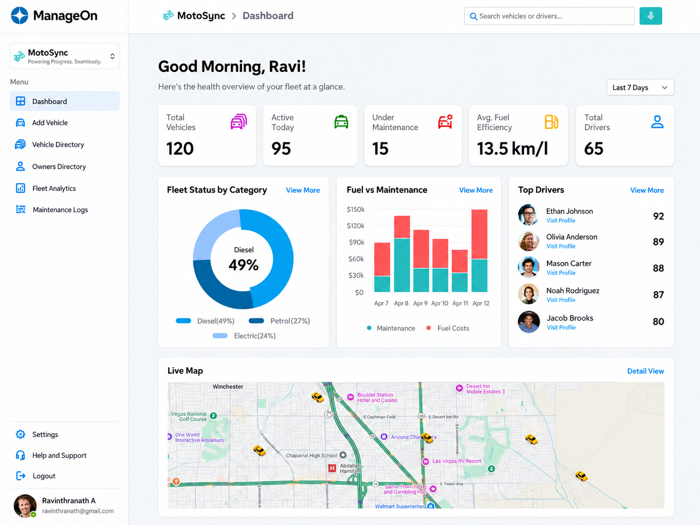
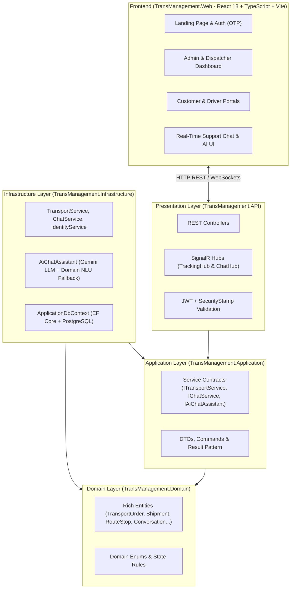

# 🚚 TransFlow — Real-Time Transportation Management & AI Support Platform (TMS)

**TransFlow (TransManagement)** là hệ thống Quản lý Vận tải & Điều phối Đội xe thời gian thực được xây dựng theo kiến trúc **Clean Architecture** với **.NET 8**, **Entity Framework Core (PostgreSQL)**, **SignalR**, **React 18 + TypeScript** và tích hợp **Trợ lý AI Hỗ trợ Khách hàng (Google Gemini API + Hybrid Domain NLU)**.

Hệ thống giải quyết trọn vẹn vòng đời vận tải khép kín cho 4 nhóm vai trò (**Admin, Dispatcher, Driver, Customer**): từ đặt đơn vận chuyển, gom đơn điều phối theo tải trọng xe, giám sát lộ trình GPS trực tuyến, ký nhận bằng chứng giao hàng điện tử (ePOD) đến hỗ trợ khách hàng tự động 24/7 bằng AI.



---

## ✨ Tính năng nổi bật (Key Features)

### 1. Phân hệ theo 4 vai trò (Role-Based Portals)
* **👤 Cổng Khách hàng (Customer Portal):**
  * Đăng ký tài khoản xác thực qua **Email OTP**, quản lý hồ sơ khách hàng.
  * Tạo đơn vận chuyển mới, theo dõi trạng thái vận đơn theo thời gian thực và hủy đơn khi đang chờ điều phối (`WaitingForAssignment`).
  * Xem vị trí GPS trực tuyến của chuyến xe đang chở đơn hàng của mình.
  * Trò chuyện trực tiếp với **Trợ lý AI TransFlow 24/7** hoặc chuyển tiếp gặp Quản trị viên qua Live Chat.
* **📋 Bảng điều khiển Điều phối viên (Dispatcher Dashboard):**
  * Quản lý danh mục Khách hàng, Tài xế, Phương tiện (`Available`, `Assigned`, `InTransit`, `Maintenance`).
  * **Gom đơn & Ghép chuyến (Shipment Consolidation):** Tự động kiểm tra ràng buộc **Tổng khối lượng (`WeightKg`) <= Tải trọng xe (`MaxLoadKg`)**, **Tổng thể tích (`VolumeM3`) <= Thể tích thùng (`CargoVolumeM3`)** và hạn bằng lái tài xế trước khi khởi hành.
  * Tự động sinh lộ trình điểm dừng (`RouteStop`: Pickup & Delivery tuần tự) trong một **Database Transaction**.
* **🚚 Cổng Tài xế (Driver Portal):**
  * Nhận danh sách chuyến xe được phân công, bấm **Bắt đầu chuyến (`Start`)** và **Hoàn thành chuyến (`Complete`)**.
  * Thực hiện tuần tự các điểm dừng (`Pending` → `Arrived` → `Completed` / `Skipped`).
  * Gửi **Bằng chứng giao hàng điện tử (ePOD - `DeliveryProof`)**: tên người nhận, ảnh chụp hoặc chữ ký điện tử khi giao hàng.
  * Phát tọa độ **GPS trực tuyến** từ trình duyệt về trung tâm điều hành qua WebSockets (`SignalR`).
* **🛡️ Bảng điều khiển Quản trị viên (Admin Dashboard):**
  * Quản trị người dùng, cấp quyền (`Admin`, `Dispatcher`, `Driver`, `Customer`), khóa/mở khóa tài khoản tức thời.
  * Liên kết hồ sơ Tài xế với tài khoản đăng nhập.
  * **Hộp thư Hỗ trợ trực tuyến (`AdminSupportInbox`):** Giám sát các cuộc hội thoại đang được AI trả lời tự động, bấm **Tiếp nhận (Assign)** để tắt AI và chat trực tiếp với khách hàng.

---

### 2. Trợ lý AI Hỗ trợ Khách hàng (Hybrid AI Customer Assistant)
* **Dynamic Context Grounding:** Khi khách hàng nhắn tin ở trạng thái hội thoại `Open`, hệ thống tự động nạp danh sách đơn hàng thực tế của chính khách hàng đó cùng lịch sử hội thoại vào System Prompt của **Google Gemini (`gemini-2.0-flash` / `gemini-2.5-flash`)** để trả lời chính xác, chống ảo giác (Anti-Hallucination) và đảm bảo cô lập dữ liệu (Tenant Isolation).
* **Agentic Actions & Domain NLU Fallback:** Hỗ trợ tự động:
  * Tra cứu chi tiết vận đơn theo mã (`ORD-...`) hoặc liệt kê toàn bộ đơn hàng của khách.
  * Bóc tách khối lượng (`kg` / `tấn`) để tư vấn loại xe tải phù hợp và tính cước phí ước tính.
  * Tự động thực thi hủy đơn (`CancelCustomerOrderAsync`) ngay trong khung chat nếu đơn ở trạng thái `WaitingForAssignment`.
  * **Chế độ dự phòng (Graceful Degradation):** Ngay cả khi không cấu hình `ApiKey` hoặc mất kết nối tới Gemini API, bộ xử lý ngôn ngữ nghiệp vụ nội bộ vẫn phản hồi 100% yêu cầu tra cứu, báo giá và hủy đơn.
* **Human-in-the-Loop (HITL):** Khi Admin bấm **Tiếp nhận** hoặc gửi tin nhắn phản hồi, hội thoại chuyển sang trạng thái `Assigned` và AI tự động nhường quyền cho nhân viên hỗ trợ.

---

## 🏗️ Kiến trúc Hệ thống (Clean Architecture)



### Cấu trúc thư mục
```text
TransManagement/
├── TransManagement.Domain/          # Rich Domain Entities, State Machines, Enums, Exceptions
├── TransManagement.Application/     # Interfaces (ITransportService, IChatService, IAiChatAssistant), DTOs, Result<T>
├── TransManagement.Infrastructure/  # EF Core PostgreSQL, Identity + OTP, TransportService, ChatService, AiChatAssistant
├── TransManagement.API/             # REST Controllers, SignalR Hubs (TrackingHub, ChatHub), JWT & GlobalExceptionHandler
├── TransManagement.Web/             # React 18 + TypeScript + Vite Frontend (Dashboard, Customer/Driver Portals, Live Map & Chat)
├── TransManagement.Tests/           # xUnit Automated Tests (Domain Invariants, Application Models, API & Chat Authorization)
└── docs/                            # Tài liệu thiết kế, cài đặt DB, cấu hình Email OTP và hướng dẫn từng giai đoạn
```

---

## 🛠️ Công nghệ sử dụng (Tech Stack)

| Tầng | Công nghệ |
| :--- | :--- |
| **Backend** | .NET 8, ASP.NET Core Web API, C# 12 |
| **Database & ORM** | PostgreSQL, Entity Framework Core 8 (Code-First Migrations) |
| **Real-Time** | ASP.NET Core SignalR (`TrackingHub` cho GPS, `ChatHub` cho Live Chat & AI Typing) |
| **AI & NLU** | Google Gemini API (`gemini-2.0-flash` / `gemini-2.5-flash`) + Built-in Vietnamese Domain NLU Engine |
| **Authentication & Security** | ASP.NET Core Identity, JWT Bearer, Rotating Refresh Tokens (SHA-256), Salted Email OTP (`FixedTimeEquals`), Real-time `SecurityStamp` validation |
| **Frontend** | React 18, TypeScript, Vite, SignalR Client (`@microsoft/signalr`), OpenStreetMap |
| **Testing** | xUnit, Coverlet |

---

## 🚀 Hướng dẫn Cài đặt & Chạy dự án (Getting Started)

### 1. Yêu cầu hệ thống (Prerequisites)
* [.NET 8 SDK](https://dotnet.microsoft.com/download/dotnet/8.0)
* [PostgreSQL 15+](https://www.postgresql.org/download/)
* [Node.js 20+](https://nodejs.org/)

### 2. Cấu hình Bảo mật & Cơ sở dữ liệu (`User Secrets`)
Tại thư mục gốc `d:\TransManagement`, khởi tạo cấu hình kết nối PostgreSQL và khóa ký JWT thông qua `.NET User Secrets`:

```powershell
# 1. Cấu hình chuỗi kết nối PostgreSQL
dotnet user-secrets set --project TransManagement.API `
  "ConnectionStrings:DefaultConnection" `
  "Host=localhost;Port=5432;Database=trans_management;Username=postgres;Password=YOUR_POSTGRES_PASSWORD;Include Error Detail=true"

# 2. Sinh khóa bí mật JWT ngẫu nhiên chuẩn mật mã (64 bytes)
$bytes = New-Object byte[] 64
$rng = [System.Security.Cryptography.RandomNumberGenerator]::Create()
$rng.GetBytes($bytes)
$rng.Dispose()
$jwtSecret = [Convert]::ToBase64String($bytes)
dotnet user-secrets set --project TransManagement.API "Jwt:SecretKey" $jwtSecret
Remove-Variable jwtSecret, bytes
```

*(Tùy chọn)* Cấu hình **Google Gemini API Key** cho Chatbot AI (nếu để trống, Chatbot sẽ tự động chạy bằng bộ xử lý ngôn ngữ nghiệp vụ tích hợp sẵn):

```powershell
dotnet user-secrets set --project TransManagement.API "AiAssistant:ApiKey" "AIzaSy_YOUR_GEMINI_API_KEY"
dotnet user-secrets set --project TransManagement.API "AiAssistant:Model" "gemini-2.5-flash"
```

*(Tùy chọn)* Cấu hình tài khoản Admin mặc định cho môi trường Development:

```powershell
dotnet user-secrets set --project TransManagement.API "DevelopmentAdmin:Email" "admin@transflow.local"
dotnet user-secrets set --project TransManagement.API "DevelopmentAdmin:Password" "Admin@12345"
```

### 3. Khởi tạo Database (EF Core Migrations)

```powershell
dotnet tool restore
dotnet restore TransManagement.sln
dotnet ef database update --project TransManagement.Infrastructure --startup-project TransManagement.API
```

### 4. Chạy Backend API & Frontend Web

**Terminal 1 — Chạy Backend API (.NET 8):**
```powershell
dotnet run --project TransManagement.API --launch-profile http
```
* Swagger UI: `http://localhost:5153/swagger`
* Health Check: `http://localhost:5153/health`

**Terminal 2 — Chạy Frontend (React + Vite):**
```powershell
cd TransManagement.Web
npm install
npm run dev
```
* Giao diện Web: `http://localhost:5173`

---

## 🧪 Chạy Kiểm thử (Running Tests)

Dự án bao gồm bộ Unit Test kiểm tra các bất biến miền (Domain Invariants), quy tắc chuyển trạng thái (State Machine), Result Pattern và phân quyền Controller/SignalR Hub:

```powershell
dotnet test TransManagement.sln
```

---

## 📚 Tài liệu chi tiết (Documentation)

* [Cài đặt PostgreSQL & EF Core Migrations](docs/database-setup.md)
* [Cơ chế Xác thực JWT, Refresh Token & Security Stamp](docs/authentication.md)
* [Cấu hình Gmail SMTP cho Đăng ký OTP](docs/gmail-otp-setup.md)
* [Thiết kế API Vận tải & Điều phối](docs/stage-4-transport-api.md)
* [Thiết kế Web Dashboard Quản trị](docs/stage-5-web-dashboard.md)
* [Cổng Khách hàng, Tài xế & Theo dõi GPS SignalR](docs/stage-6-portals-and-tracking.md)

